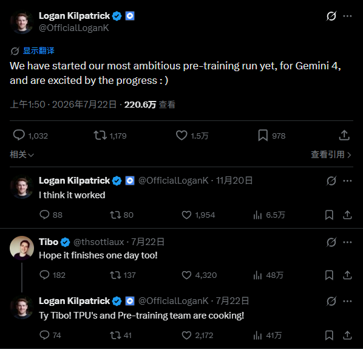
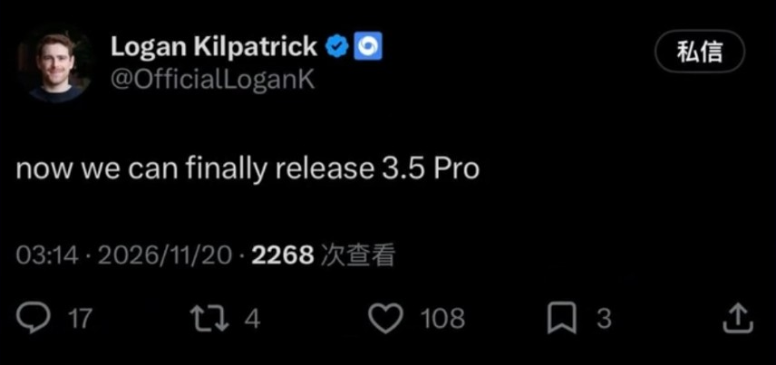

前几个月，Gemini 在不少人嘴里还是"北美大豆包"：便宜、量大、凑合能用，但没人拿它当第一梯队。最近风向全变了，新模型一个接一个往外发，一个比一个能打，硬是挤进了前沿模型那一桌。这期间我在 X 上看到一段对话，前后隔了四个月，看完挺有感触，想写下来。

<!-- more -->

先说背景。今年上半年是谷歌最难看的一段时间。年初开发者大会上，他们说旗舰模型 Gemini 3.5 Pro 六月一定发。结果六月没发，七月也没动静。外面的消息一条比一条难听：内部代码测试不达标，底座要推倒重来，还有股民起诉、股价大跌。

就在这个当口，7 月 21 号（美国时间），Google DeepMind 的产品负责人 Logan Kilpatrick 发了条推：

> We have started our most ambitious pre-training run yet, for Gemini 4, and are excited by the progress : )
>
> 我们启动了迄今为止最有野心的一次预训练，为 Gemini 4 准备的，进展让我们很兴奋 : )

话说得挺体面。可 3.5 Pro 还没影儿，又冒出来一个 Gemini 4，换谁看都像在画饼。对家的 Tibo 就在底下回了一句：

> Hope it finishes one day too!
>
> 希望这个也有跑完的一天！

那个 "too" 用得很损。翻成大白话就是：上一张饼还没画圆，又画了张更大的，祝你们这辈子能跑完吧。

被人当众这么踩在伤口上，换成我大概会忍不住回怼两句。Logan 只回了一句：

> Ty Tibo! TPU's and Pre-training team are cooking!
>
> 谢谢 Tibo！TPU 和预训练团队正在加紧干！

没生气，也没解释。那会儿评论区基本是来看谷歌笑话的，还有人直接留言说"你们什么都做不成，太让人失望了"。

后来的事大家都看到了。谷歌没在卡死的 3.5 Pro 上继续死磕面子，把资源压到了下一代上。从九月底开始，一个多月里 Argon、Carbon、Hydrogen 接连露面，然后是这两天刚刷屏、好几项跑分反超对手的 Gemini 4 Neon，预告里还排着 XNeon 和 Sodium。再加上内部据说已经差不多成型的 RSI，这张牌桌算是被谷歌硬生生掀了回来。

11 月 20 号凌晨三点多，Logan 翻出四个月前那条被人嘲笑的推，在自己原帖下面回了一句：

> I think it worked
>
> 我觉得成了。

没带情绪，也没 @ 谁。可在对话串里，这句话正好排在 Tibo 那句"希望这个也有跑完的一天"的正上方。

两分钟后，他又自嘲了一句："现在，我们终于可以发 3.5 Pro 了。"

看完这两张图，我心里挺受触动的。硅谷大佬之间的爽文反转谁都爱看，不过我更在意里面的两个道理，对我们普通人也适用。

**第一，被人质疑的时候，吵赢了没用，做成了才有用。**

七月那会儿，Logan 要是在评论区跟人辩一万句"我们技术其实很强"，只会显得又苍白又好笑。他把那口气咽了下去，团队埋头在代码和算力里干了四个月，把东西做了出来。到了那天，根本不用大声反驳，轻描淡写一句"我觉得成了"，比什么狠话都响。

**第二，人生和工作里，很多时候需要一点"跳过 3.5"的勇气。**

我们太容易被沉没成本拖住了。一个明明已经跑不通的项目，一段一直在消耗自己的关系，就因为当初对外许过承诺，怕半路停下丢脸，于是一直死磕。谷歌这次能翻盘，恰恰是因为他们认了阶段性的失败，没再去补 3.5 Pro 那个到处漏风的窟窿，转头开了 Gemini 4 这一局更大的。

如果你最近也正被人质疑，或者怎么努力都还没看到结果，正卡在自己的"延迟期"里，不妨想想这段对话，给自己一点底气。先别急着跟谁争，也别死盯着眼前卡住的那个版本不放。把头埋下去，准备你的"下一代模型"。等哪天做成了，当初让你最难堪的那些话，大概都能笑着讲出来。
