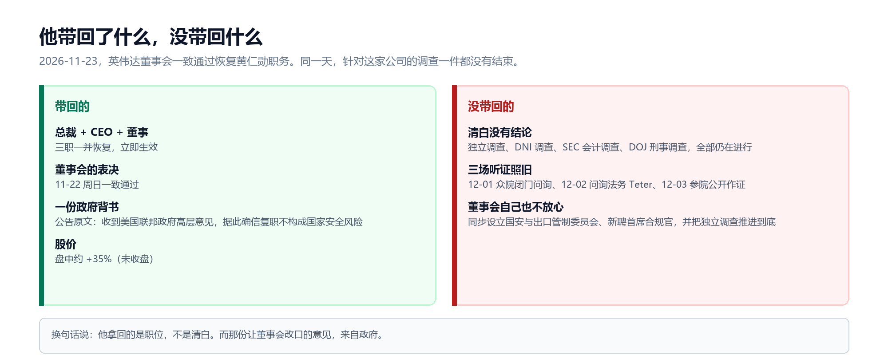

六天前，11-17 的财报电话会上，英伟达董事会主席说得很清楚：董事会一致接受辞呈，不打算让他重新担任 CEO。

11-23 开盘前，还是这个董事会，一致通过恢复他的总裁、CEO 与董事三职。

随附新闻稿里写明的依据，值得逐字读一遍：<strong>“董事会收到了来自美国联邦政府高层的意见，基于该意见，董事会确信黄仁勋的复职不构成国家安全风险。”</strong>

<!-- more -->

标题就是从这句话来的。让他回来的是政府的一份担保，调查还没有给他任何结论。

## 发生了什么

董事会 11-22（周日）表决，11-23 早上八点五十五分、开盘前发布公告，立即生效。临时 CEO Colette Kress 回去当执行副总裁兼 CFO，Harvey Jones 继续担任董事会主席。

特朗普当天对 CNBC 说，复职前他跟董事会“直接和间接”都谈过。董事会“确实要求对国家安全威胁作出保证”，他“给了保证”。他的原话是黄仁勋“did nothing wrong”。

一家上市公司做人事决定，公告里把依据写成“政府高层意见”，这在公司治理里很少见。Interactive Brokers 的策略师 Sosnick 说得很直白：<strong>“某种程度上说明，黄仁勋大到不能被开除。”</strong>

## 他没带回清白

风险全在下面这张表里：

| 仍在进行的事 | 状态 |
|---|---|
| 董事会独立调查 | 公告明确要求“进行到底” |
| 国家情报总监办公室调查 | 11-22 称对本人及公司仍在进行 |
| SEC 会计调查 | 正审查其地区收入口径变更 |
| DOJ 刑事调查 | Megaspeed 涉嫌走私芯片案未结 |
| 三场国会作证 | 12-01 众院闭门、12-02 问询法务 Teter、12-03 参院公开 |

董事会自己也不放心。复职的同时，它设立了一个全部由独立董事组成的国家安全与出口管制委员会，新聘了首席合规官，还承诺把独立调查推进到底。结论要是已经清楚，用不着这三道机制。

Alice Huang 那条线也没有新进展：她仍然只是被报道怀疑，司法部没有作出认定，新加坡警方说没有就间谍行为调查她，中国外交部否认了相关说法。

## 市场那一栏

复职当天，英伟达盘中一度涨了约 **35%**，市值增加约 **9,000 亿美元**，纳指盘中涨约 7%。以上都是写作时的盘中数据。

换算一下就没那么热闹了。从 11-08 承认婚外情算起，股价累计跌了近 33%。0.67 × 1.35 ≈ 0.905，一天收复了大半，仍比 11-08 低约 9.5%。

*图 1：复职带回了职位、董事会表决、一份来自政府的意见和股价。四项调查与三场听证全部照旧，董事会还新设了三道监督机制。*

## 账记到了谁头上

我们在[上一篇](/2026/11/13/2026-11-13-jensen-huang-resignation-political-guarantor/)里说，英伟达失去的是对华政策的政治担保人。这一周应验了：担保人没有替补，所以董事会连 CEO 带担保人一起请了回来。

代价也跟着挪了地方。<strong>这次复职把英伟达的国家安全风险，从“公司合规问题”抬成了“政府信用问题”</strong>。以后英伟达再出事，账要记到白宫头上。

参议员 Warren 称这个决定“鲁莽”，说它只会让两党的出口管制法案更急着通过。明年 1 月起，她出任参院银行委员会主席。

---

### 主要信息来源

- [英伟达官方新闻稿（2026-11-23）：董事会恢复黄仁勋职务](https://nvidianews.nvidia.com/news/nvidia-board-reinstates-jensen-huang-as-president-ceo-and-board-director)
- [英伟达 8-K 文件（事件日期 2026-11-22，SEC EDGAR）：载明董事会复职与 Kress 回任 CFO；“政府高层意见”一段出自其附件 99.1 新闻稿](https://www.sec.gov/Archives/edgar/data/1045810/000104581026000090/nvda-20261122.htm)
- [CNBC（2026-11-23）：特朗普称曾为黄仁勋复职向董事会作出保证](https://www.cnbc.com/2026/11/23/trump-nvidia-jensen-huang.html)
- [CNBC（2026-11-23）：政府简报如何推动董事会改口](https://www.cnbc.com/2026/11/23/nvidia-jensen-huang-ceo.html)
- [CNBC（2026-11-23）：情报总监称对 Alice Huang 及其公司的调查仍在进行](https://www.cnbc.com/2026/11/23/nvidia-megaspeed-chipmaker-us.html)
- [Reuters（2026-11-23）：议员批评英伟达复职决定](https://www.reuters.com/business/lawmakers-criticize-nvidia-decision-reinstate-huang-ceo-2026-11-23/)
- [Reuters（2026-11-20）：SEC 正审查英伟达潜在会计问题](https://www.reuters.com/world/us-secs-nvidia-probe-is-examining-potential-accounting-issues-sources-say-2026-11-20/)
- [NYT（2026-11-22）：据看过情报报告的人士，Alice Huang 与中方官员保持联系](https://www.nytimes.com/2026/11/22/us/politics/alice-huang-china-spy-agency-nvidia.html)

---

*文中股价与市值为 2026-11-23 盘中数据，百分比为换算结果，不构成投资建议。*

*封面图片：[People Standing with Documents](https://www.pexels.com/photo/people-standing-with-documents-8730283/) — Photo by Mikhail Nilov on Pexels（授权免费商业使用）*
